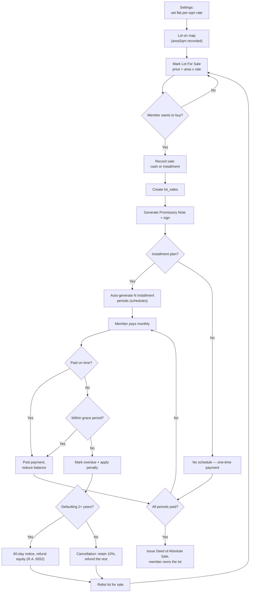
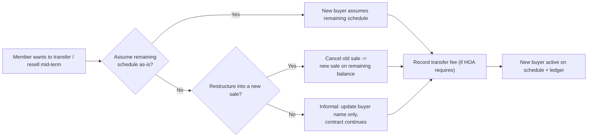

# Flow Reference — The Payment Scheme (how it works, step by step)

**Date:** 2026-10-28
**Purpose:** A working functional reference for planning how the system should behave. It records the current proposed flows and data model; it is not a final coding specification until the open policy decisions in the planning checklist are resolved. No implementation is authorized by this document alone.

**Conventions**
- **Box** = an action/process (the system or a user does something)
- **Diamond** = a decision point — **always yes/no** (per adviser instruction)
- **Write** = fields the step saves (which collection, which values)
- **Read** = what the step needs to know
- IDs connect records — no hand-typed links anywhere (Flow 12)

---

## 0. The one diagram — everything in a single picture

---

## 1. The entities and how they connect

| Entity (collection) | What it is | Key fields |
|---|---|---|
| `sales_rate/config` | The default selling rate per sqm (single doc) | `ratePerSqm`, `updatedBy`, `updatedAt` |
| `lots` | The lots on the map and their current asking-price configuration | `id`, `phase`, `block`, `lotNumber`, `areaSqm`, `status`, `uid` (assigned/current owner), `price`, `pricingType`, `basePrice`, `adjustmentAmount`, `pricingReason`, `pricingApprovedBy`, `pricingApprovedAt`, `updatedBy`, `updatedAt` |
| `members` | The member/user accounts | `uid`, `displayName`, `email`, `status`, `contactNumber`, `address`, `photoUrl`, `lotNumber`, `phase` |
| `lot_sales` | One sale of one lot to one buyer | `lotId`, `buyerUid`, `totalPrice` (sale-time snapshot), `basePrice`, `pricingType`, `adjustmentAmount`, `pricingReason` (if applicable), `downPayment`, `financedAmount`, `termMonths`, `rate`, `monthlyPayment`, `status`, `soldDate` |
| `lot_payments` | One installment period | `saleId`, `lotId`, `period`, `transactionId`, `dueDate`, `amount`, `principalPortion`, `interestPortion`, `remainingBalance`, `status`, `paidAt` |
| `payments` | Legacy dues/fees records | `uid`, `type`, `amount`, `status`, `dueDate`, `lotId` (unchanged) |
| `member_ledgers` | Per-member outstanding balance | `uid`, `annualTarget`, `currentBalance`, `year` |

**How they connect (relationships):**
- `lot_sales.lotId` → `lots.id` (which lot is sold)
- `lot_sales.buyerUid` → `members.uid` (who bought it)
- `lot_payments.saleId` → `lot_sales.id` (which sale the payments belong to)
- `lots.uid` → `members.uid` (who currently owns the lot)
- Member screens link to lots via `members.uid` ↔ `lots.uid` (two-way)

**ID generation:**
- `transactionId` format: `LP-{YY}-{saleSeq}-{period}` e.g. `LP-2026-001-007`
- `saleSequence` = a counter stored per year (incremented when a sale is recorded)
- All generated when the sale is recorded (Flow 4)

---
## Planning status — decisions before coding

This Markdown file is a planning reference only. We can continue reviewing the workflow, screens, data model, and policy choices before any code changes begin. Do not treat examples, sample prices, or unresolved decisions below as approved HOA policy.

### Confirmed direction so far

- All lot payments are received **in person at the HOA cashier**. The system records and tracks payments; it does not collect money online or initiate bank transactions.
- Cash is recorded as paid only after the cashier receives it. Cheque and bank-transfer payments remain `pendingVerification` until an authorized officer confirms receipt/clearing; only then may they be posted as paid.
- The default selling rate is planned as ₱2,000/sqm, but the HOA must confirm the actual value before launch.
- Some lots may have an approved price exception (for example, a corner lot or special location). The example factors are not a mandated premium; the HOA must decide which factors qualify and who approves them.
- We are not proceeding to coding yet. Use the checklist at the end to settle outstanding decisions first.

---

## 1b. Panelist requirements — recorded and mapped to the flows

The notes below are the panel review feedback. Each item is answered by the flows in this document, so the design traces directly back to what was raised.

| # | Panelist note | What it means for the system | Answered by |
|---|---|---|---|
| 1 | **"In Add Member, connect registration of member to location mapping to assign lots / membership"** | Registering a member assigns them a lot via the location map — the member ↔ lot link is created at registration, not typed by hand. | Flow 12a (admin picks the lot from the map), Flow 12b (self-registration picks Phase · Block · Lot), "How they connect" (Section 1) |
| 2 | **"Lot / payment modules are insufficient — this is for the current system"** | The current lot + payment modules are being expanded into a full sales & payment scheme; this document supersedes them. | All flows 01–12 (pricing, sales, schedules, payments, reports, documents) |
| 3 | **"Includes payment modes like installment and others, lot amount, down payment, due dates, monthly amortization"** | The payment module supports multiple modes and carries the full payment terms, not just a simple "paid/unpaid" flag. | Payment modes: Flow 03 (cash/full) + Flow 04 (installment). Lot amount: Flow 02 (area × rate) + `lot_sales.totalPrice`. Down payment, due dates, monthly amortization: Flow 04 (schedule generation) |

### Payment modes (explicit list)

| Mode | Payment basis | Schedule | Flow |
|---|---|---|---|
| Cash (full) | One payment = total lot amount | None | 03 |
| Installment (monthly amortization) | Equal monthly payments split into principal + interest | Auto-generated from `termMonths` and rate | 04 |

Every installment period carries `period`, `transactionId`, `dueDate`, `amount`, `principalPortion`, `interestPortion`, `remainingBalance` — so **lot amount, down payment, due dates, and monthly amortization** are all explicit in the generated schedule (Flow 04).

---

## Flow 01 — Set the default rate (admin, once)

**Trigger:** HOA officer opens Settings → Lot Pricing → enters the default selling rate per sqm.

1. (Read) Current `sales_rate/config` if it exists.
2. (Decision) `Is the rate valid and positive?` — No → reject and explain; Yes → continue.
3. (Write) `sales_rate/config`: `ratePerSqm = <amount>`, `updatedBy = <who>`, `updatedAt = now`.
4. The default price for a lot is `areaSqm × ratePerSqm` unless an authorized per-lot exception is approved (Flow 02).

**Logic:** one default rate for the subdivision for now. Changing the default rate must not silently rewrite the agreed price on an existing sale. The price agreed at sale time is stored as a snapshot on `lot_sales`.

**Planning note:** ₱2,000/sqm is the current working example, not a final value until the HOA approves it.

---

## Flow 02 — Price a lot and mark it for sale (admin, per lot)

**Trigger:** Admin opens a Vacant lot on the map → taps “Mark For Sale” or “Edit Price”.

1. (Read) The lot's `areaSqm`, current `sales_rate/config`, and any saved pricing configuration for the lot.
2. (Decision) `Does the lot have area recorded?`
   - **No** → block the action and prompt: “Enter the lot area (sqm) first.” End.
   - **Yes** → continue.
3. (Decision) `Does the default rate exist and have a valid positive value?`
   - **No** → block and prompt the admin to set the default rate in Settings. End.
   - **Yes** → continue.
4. Calculate `basePrice = areaSqm × ratePerSqm`, rounded to 2 decimal places.
5. (Decision) `Does this lot need a price exception?`
   - **No** → set `pricingType = 'standard'`, `adjustmentAmount = 0`, and `finalPrice = basePrice`.
   - **Yes** → authorized admin selects a reason/type, enters an adjustment, and supplies a written reason. Proposed types: `cornerPremium`, `specialLocation`, `custom`. The final price is `basePrice + adjustmentAmount`. If a discount is needed, a negative adjustment is allowed only if the HOA approves that policy.
6. (Decision) `Is the exception approved by an authorized approver?`
   - **No** → do not mark the lot for sale at the exception price; keep the price as standard or leave the lot unlisted until approval.
   - **Yes** → save the approved exception metadata.
7. Show a price preview with the area, rate, base price, adjustment, reason, approver (when applicable), and final price. (Decision) `Proceed?`
   - **Yes** → (Write) `lots/{lotId}`: `status = 'forSale'`, `price = finalPrice`, `pricingType`, `basePrice`, `adjustmentAmount`, `pricingReason`, `pricingApprovedBy`, `pricingApprovedAt`, `updatedBy`, `updatedAt`.
   - **No** → no write; return to the edit screen.

**Proposed lot pricing fields:**

| Field | Purpose |
|---|---|
| `pricingType` | `standard`, `cornerPremium`, `specialLocation`, or `custom` |
| `basePrice` | `areaSqm × default rate` at the time the asking price is calculated |
| `adjustmentAmount` | Approved fixed amount added to or, if policy allows, subtracted from base price |
| `price` | Final asking price shown on the map and used when opening a sale |
| `pricingReason` | Required explanation for any exception |
| `pricingApprovedBy` / `pricingApprovedAt` | Audit record of who approved the exception and when |

**Example only, not an approved price policy:** a 100 sqm lot at ₱2,000/sqm has a base price of ₱200,000. If the HOA approved a ₱50,000 corner-lot adjustment, the final price would be ₱250,000. Do not hard-code this sample adjustment.

**Important:** when a sale is confirmed, copy the agreed `price`, `pricingType`, `basePrice`, and `adjustmentAmount` into the `lot_sales` record as sale-time snapshots. Later changes to the default rate or lot asking price must not alter an existing contract or payment schedule without an authorized amendment process.

**Effect on map:** pin shows “For Sale” and the final asking price. The lot detail should make it clear whether the price is standard or includes an approved exception.

---

## Flow 03 — Record a CASH sale (installmentplan = No)

**Trigger:** Admin opens a For-Sale lot → "Record Sale" → mode = Cash, picks buyer.

1. (Read) The lot (`id`, `price`); pick buyer from `members` (search by name/email).
2. (Write) `lot_sales/{newId}`:
   - `lotId`, `lotNumber`, `phase`, `block` (snapshot), `buyerUid`, `buyerName` (snapshot)
   - Price snapshot: `basePrice`, `pricingType`, `adjustmentAmount`, `pricingReason` (when applicable)
   - `saleType = 'cash'`, `totalPrice = lot.price`, `downPayment = totalPrice`, `financedAmount = 0`
   - `termMonths = 0`, `monthlyPayment = 0`, `status = 'active'`, `soldDate = now`, `createdBy`, `updatedAt`
3. Cashier receives and confirms the in-person payment. (Write) `payments/` (a single full-payment record): `uid = buyerUid`, `type = 'lotPayment'`, `amount = totalPrice`, `status = 'paid'`, `dueDate = now`, `paidAt = now`, `paymentMethod = 'cash'`, `lotId`, `notes = 'full cash payment'`. This is a record of money received, not an online payment transaction.
4. (Write) `lots/{lotId}`: `status = 'occupied'`, `uid = buyerUid`, `ownerName = buyerName`, `updatedBy`, `updatedAt`.
5. Generate Promissory Note / issue Receipt (Flow 11) — Deed of Sale issued here (Flow 09).

**Effect:** lot is owned immediately, balance = 0, no schedule.

---

## Flow 04 — Record an INSTALLMENT sale (auto-generate schedule)

**Trigger:** Admin opens a For-Sale lot → "Record Sale" → mode = Installment, picks buyer, sets terms.

**Inputs from admin:**
- Buyer (member), down payment (default 0), term months (e.g. 120), annual interest rate (e.g. 6%), first due date (default next month 1st).

**Steps:**

1. (Read) Lot (`price`). Compute `financedAmount = totalPrice − downPayment`.
2. (Decision) `Is financedAmount > 0?`
   - **No** → treat as cash sale (Flow 03). End.
   - **Yes** → continue.
3. Compute **monthly payment** with standard amortization:
   - `r = annualInterestRate / 12`, `n = termMonths`
   - `M = financedAmount × r × (1+r)^n / ((1+r)^n − 1)`  (if interest = 0, `M = financedAmount / n`)
4. (Decision) `Does monthly payment look valid?` (M > 0, finite) → **No** → stop with error. **Yes** → continue.
5. (Write) `lot_sales/{newId}` (once):
   - `saleType = 'installment'`, `totalPrice`, `downPayment`, `financedAmount`, `termMonths`, `annualInterestRate`, `monthlyPayment`, `status = 'active'`, `soldDate`, `createdBy`, `updatedAt`
6. Loop over `period = 1..n`, building the schedule (pure math, no writes yet):
   - For each period: `interestPortion = remainingBalance × r` (0 if no interest), `principalPortion = M − interestPortion`, `remainingBalance = previousBalance − principalPortion` (last period: adjust so balance = 0).
   - `dueDate = firstDue + (period − 1) months`.
7. (Write) `lot_payments/` — ONE doc per period (unless already created for this sale — idempotent):
   - `saleId`, `lotId`, `period`, `transactionId = LP-YY-SEQ-PERIOD`, `dueDate`, `amount = M`, `principalPortion`, `interestPortion`, `remainingBalance`, `status = 'scheduled'`, `createdAt`.
8. If `downPayment > 0`: (Write) a `lot_payments` period `0` record, `status = 'paid'`, `paidAt = now` (transaction ID `LP-YY-SEQ-000`).
9. (Write) Promissory Note document (Flow 11) containing the full schedule.
10. (Write) `lots/{lotId}`: `status = 'occupied'`, `uid = buyerUid`, `ownerName`, `price = totalPrice`, `updatedBy`, `updatedAt`.

**Effect (automation):** one sale → schedule fully generated, each period with its own transaction ID and running balance.

---

## Flow 05 — Record a payment (member pays, admin posts)

**Trigger:** Cashier/officer opens the lot / member → “Record Payment”, enters amount, actual receipt date, and payment method after the member presents payment in person.

**Supported recording methods:**
- `cash`: may be marked `paid` once physically received by the cashier.
- `cheque`: save as `pendingVerification` until the authorized officer confirms that it has cleared; do not reduce the confirmed outstanding balance before verification.
- `bankTransfer`: save as `pendingVerification` until the officer verifies the transfer in the HOA's bank account; the system does not initiate or process the transfer.

Each payment record should retain `paymentMethod`, `recordedBy`, `recordedAt`, `verifiedBy`/`verifiedAt` when applicable, a receipt/reference number, and a status-change audit trail. Prevent duplicate posting of the same payment/reference. Final field names and cheque/bank verification rules remain subject to planning.

1. (Read) The sale's `lot_payments`, sorted by `period`; find the **first unpaid** period (status ≠ paid).
2. (Decision) `Is there an unpaid period?`
   - **No** → nothing to pay; prompt "Sale is already paid off." End.
   - **Yes** → continue.
3. (Decision) `Does the payment cover the current period's amount?`
   - **Yes** → mark current period `paid`.
   - **No** (partial) → (Decision) `Accept partial? (HOA policy Q11)` — Yes → post partial as a credit/partial on this period (keep status `scheduled`, track `paidAmount`); No → reject with "exact amount required".
   - **More than the amount** (overpayment) → pay current period, carry remainder to the **next** unpaid period(s); repeat until remainder = 0 or periods exhausted.
4. (Write) for each period actually covered: `lot_payments/{id}`:
   - `status = 'paid'`, `paidAt = now`, `paidBy = <officer>`
5. (Write) `lot_sales/{id}`: recalc `status='paidOff'` when balance hits 0 (see Flow 09).
6. Receipt reference: show the covered periods' `transactionId`s.

**Effect:** balance always decreases; overpayment auto-flows forward; every paid period has its transaction ID + paidAt + who recorded it.

---
## Flow 06 — Overdue + penalty (automatic check)

**Trigger:** A `lot_payments` period with `status = 'scheduled'` passes its `dueDate` + `graceDays` (from HOA settings, e.g. 5 days).

Could run as: a scheduled job (cloud function/定时) or on-read display logic. Recommended: **display-time** (no auto job needed) — same pattern the system already uses for `displayStatus` on `payments`.

1. (Read) `lot_payments` where `status ≠ paid` and `dueDate < startOfToday`.
2. For each such period, **display as `overdue`** (`displayStatus` getter — never write `overdue` to storage automatically).
3. (Decision) `Has the overdue period been flagged before?`
   - **No** → (Write) `lot_payments/{id}`: `penaltyApplied = true`, `penaltyAmount = <flat penalty from settings>`, `balanceAfterPenalty = remainingBalance + penalty`. NOTE: only when the HOA implements penalties on installments (confirm in interview Q13). If not, skip — status shows overdue only.
   - **Yes** → no repeated penalty (penalty is applied once per period).
4. Overdue periods roll into Flow 07 if the HOA decides to act (demand → cancel).

**Logic note:** the stored `status` field on a period is only ever set by an explicit admin action (`paid`, `waived`) — `overdue` is derived at display time so nothing auto-flips silently.

---

## Flow 07 — Default / cancellation (HOA decision, per R.A. 6552)

**Trigger:** Officer/Admin reviews an overdue account and decides to proceed with the default process (mounts of unpaid months per HOA policy, interview Q18).

1. (Decision) `Has the buyer paid installments covering 2+ years?` (sum of paid periods ≥ 24, or ≥ 24/120 of the schedule — confirm exact threshold with HOA)
   - **Yes** → (Write) demand letter workflow: 60-day notice to cure (record `noticeSentAt` on `lot_sales`). (Decision) `Did they cure?` → **Yes** → continue as normal payments (back to Flow 05). **No** → buyer entitled to refund of equity (R.A. 6552) → go to step 3.
   - **No** → cancellation: HOA can retain up to 10% of total payments; refund the balance (per R.A. 6552) → go to step 3.
2. (Write) `lot_sales/{id}`: `status = 'cancelled'`, `cancelledAt = now`, `cancelledBy`, `refundAmount = <computed>`, `reason`.
3. (Write) For every unpaid period: `lot_payments/{id}` `status = 'void'` (kept for audit, not counted as collectible). Paid periods stay as history.
4. (Decision) `Refund issued?` → **Yes** → (Write) `payments/` a negative/refund record `type = 'lotPayment'`, `amount = refund`, `notes = 'R.A. 6552 refund'`. → relayed to Flow 02 (relist lot for sale).
5. (Write) `lots/{lotId}`: `status = 'forSale'`, `uid = null`, `ownerName = null`, `price = <current rate × area>`.

**Effect:** the cycle restarts — the lot goes back on sale (Flow 02 → 03/04).

---

## Flow 08 — Transfer / resale mid-term (Decision 5 — options kept open)

**Trigger:** A member wants to sell/transfer their lot while installments are still running, or before full payment.

The yes/no chain (per adviser's instruction):

- **Option A (assume):** (Write) `lot_sales/{id}`: `buyerUid = newBuyer`, `buyerName`, `status = 'assumed'`→ reopen as active under new buyer; (Write) unpaid `lot_payments`: `buyerUid`/`buyerName = newBuyer`. Schedule, amounts, term, transaction IDs ALL unchanged.
- **Option B (restructure):** close old sale (`status = 'cancelled'`, reason `restructured`), void unpaid periods (Flow 07 step 3), then run Flow 04 again with `financedAmount = remainingBalance` and new terms → brand new schedule.
- **Option C (informal):** only update `buyerUid`/`buyerName` on `lot_sales` and unpaid periods; keep contract terms/schedule untouched.
- If the HOA charges a **transfer fee**: (Write) `payments/` type = `other`, amount = transfer fee (or a dedicated `transferFee` field on the sale).

**Effect:** new owner is linked to the lot (`lots.uid`) and the ledger moves to them; the full history of paid periods remains under the previous buyer for audit.

---

## Flow 09 — Paid off → issue Deed of Absolute Sale

**Trigger:** The last unpaid installment is paid (Flow 05), or a cash sale is recorded (Flow 03).

1. (Read) `lot_payments` for the sale; (Decision) `Is all remainingBalance = 0 and every period paid?`
   - **No** → nothing (payments continue).
   - **Yes** → continue.
2. (Write) `lot_sales/{id}`: `status = 'paidOff'`, `paidOffAt = now`.
3. (Write) `lots/{lotId}`: `status = 'occupied'` (already), ensure `uid`/`ownerName = buyer` — owner confirmed.
4. Generate / link the **Deed of Absolute Sale** document (see Flow 11) and the final statement showing balance = 0.
5. (Option) Ledger: `member_ledgers/{buyerUid}` `currentBalance = 0` for this lot.

**Effect:** the lot's lifecycle ends at "owned, fully paid" — the audit trail holds every payment that led there.

---
## Flow 10 — Reports (preview first, then export)

**Trigger:** Officer opens Reports → sets filters.

1. (Read) Filters chosen: date range (due date / paid date), payment type, sale, phase, member.
2. Build the dataset (rows) — **the exact same rows the export will use**:
   - **Lot statement (per sale):** period, transactionId, dueDate, amount, principalPortion, interestPortion, remainingBalance, status.
   - **Per-sale summary:** lot, buyer, totalPrice, downPayment, term, monthlyPayment, totalPaid, remainingBalance.
   - **Aggregates:** totals by phase/status if needed.
3. **Preview** — render the rows on screen (table or cards). (Decision) `Is the preview correct?`
   - **No** → adjust filters, back to step 1.
   - **Yes** → continue.
4. (Decision) `Export format?` → **CSV** → (Write) `lamhoai_lotpayments_<ts>.csv` from the same rows. → **PDF** → (Write/pdf) A4 report with HOA letterhead from the same rows, then share/print.

**Logic rule:** Preview and export are generated from one shared dataset function — they can never differ.

---

## Flow 11 — Promissory Note & documents (generate / store)

**Trigger:** A sale is recorded (Flow 03 cash or Flow 04 installment).

**Generate:**
1. (Read) `lot_sales/{id}`, the buyer `members/{uid}`, the HOA `hoa_settings`.
2. Build the PN: buyer name/address, lot (`phase · block · lotNumber`, area, price), down payment, financed amount, rate, term, monthly payment, first due date, **full schedule table** (from `lot_payments`).
3. (Write) a PDF to the sale record: `lot_sales/{id}.promissoryNoteUrl` (storage URL) or attach file reference.
4. Buyer + HOA sign (wet or e-sign, per HOA policy — interview Q21–Q23). (Write) `lot_sales/{id}`: `promissoryNoteStatus = 'signed'`, `signedAt`, `signedBy`.

**Deed of Absolute Sale** — at Flow 09 (paid off) or Flow 03 (cash): similar generation, issued to the new owner.

**Store:** signed PDFs saved under the sale record, accessible from the Lot Dashboard (Flow 12).

---

## Flow 12 — Registration + linking (Location Mapping is the entry point)

### 12a. Admin adds a member — registration linked to Location Mapping (Panelist note 1)

**Trigger:** Admin → Members → Add Member. **Registration is always linked to the location map — a member is not saved until a lot is assigned from the map.**

1. (Read) available lots (not owned/not sold); search by phase/block/lot on the map.
2. (Decision) `Select a lot from the map?`
   - **No** → block saving. Prompt: "Select the member's lot on the Location Mapping first." End — member is NOT created without a map-linked lot.
   - **Yes** → `phase`, `block`, `areaSqm` auto-fill from the chosen lot (no free text, no "Block 1" default). Continue.
3. (Write) `members/{uid}`: `displayName`, `email`, `status = 'active'|'pending'` (admin choice), `contactNumber`, `address`, `photoUrl` (optional), `lotNumber`, `phase`.
4. (Write) `lots/{lotId}`: `uid = memberUid`, `ownerName` (member is now assigned to this lot / membership), `updatedBy`.
5. Create Firebase Auth account + send email verification (existing behavior, improved validation: stronger password, duplicate-lot check).
6. The member's record and the map pin now show the same lot — the location map is the source of truth for lot assignment.

**Effect:** registration → location mapping → lot/membership assignment is one connected flow, exactly as the panelist required. The free-text "Block 1" problem is gone, and the map shows the owner.

### 12b. Member self-registration (Phase 2 — optional, pending HOA decision Q31)

1. Member opens app → "Create an account" → step 1: name, email, password (8+), contact.
2. Step 2: pick Phase · Block · Lot from the map/list.
3. Step 3: agree to community rules → submit.
4. (Write) `members/{uid}` with `status = 'pending'`, `role = 'member'`.
5. Send email verification. Account **cannot log in until verified** and admin-approve.
6. Admin sees a verification queue → (Decision) `Approve?` → **Yes** → `status = 'active'`, lot linked. **No** → stays pending (or rejected).

---

## 3. Master checklist — "every feature maps to a flow"

| Feature | Flow |
|---|---|
| Set/turn the per-sqm rate | 01 |
| Price a lot from the map | 02 |
| Sell a lot cash | 03 |
| Sell a lot on installments → schedule auto-generated | 04 |
| Post a member's payment (exact / partial / overpay) | 05 |
| Late payment shows overdue + penalty | 06 |
| Cancellation & refund per R.A. 6552 | 07 |
| Resale / transfer mid-term (A · B · C) | 08 |
| Fully paid → Deed of Absolute Sale | 09 |
| Preview & export reports (same rows) | 10 |
| Promissory Note & Deed generation/storage | 11 |
| Register members + link to map lots (Panelist note 1) | 12 |
| Payment modes: cash / installment, lot amount, down payment, due dates, monthly amortization (Panelist note 3) | 02 · 03 · 04 |

**Benefit of this format:** each flow is a self-contained unit — the UI screen, the service function, and the tests can each be built around one flow, and the yes/no decisions map 1:1 to `if/else` branches in code.

---

## Planning checklist — resolve before implementation

These are open decisions, not coding tasks. Mark each as agreed only after the HOA/project adviser confirms it.

- [ ] **Default rate:** confirm whether ₱2,000/sqm is the approved starting rate and who can change it.
- [ ] **Exception pricing:** decide which reasons qualify (corner, frontage, special location, custom), whether adjustments are fixed amounts or percentages, whether discounts are allowed, and who approves each exception.
- [ ] **Price changes:** decide whether a for-sale lot can be repriced after being listed and what audit/approval is required. Preserve the signed/agreed sale price on existing sales.
- [ ] **Sale confirmation:** define exactly when a lot becomes reserved, sold, or occupied, and separate lot assignment/member registration from a confirmed sale and legal ownership transfer.
- [ ] **Payment verification:** approve the status workflow for cash, cheque, and bank transfer; define receipt numbering and how duplicate references are handled. All payment collection remains in person.
- [ ] **Partial payments and overpayments:** decide whether partial installments are accepted, how excess amounts are allocated, and whether advance payments are permitted.
- [ ] **Interest and terms:** confirm permitted terms, interest rules, down-payment rules, due-date convention, rounding, and final-installment adjustment.
- [ ] **HOA dues:** decide whether lot installments and recurring HOA dues share a cashier workflow but remain separate balances and reports.
- [ ] **Overdue and penalties:** confirm grace period, penalty amount/method, when penalties start, and who may waive them.
- [ ] **Cancellation, refunds, transfers, and legal documents:** have the HOA/adviser verify policy and legal requirements before implementing any automatic cancellation/refund or document issuance. Existing illustrative legal logic is not a substitute for legal review.
- [ ] **Roles and audit:** decide who may set prices, approve exceptions, record payments, verify non-cash payments, cancel sales, transfer buyers, and export reports.
- [ ] **Documents and reports:** confirm required receipt, promissory note, deed, statements, export formats, retention, and access permissions.
- [ ] **Acceptance tests:** agree on examples for standard pricing, exception pricing, cash sale, installment schedule, pending cheque/bank transfer, partial payment, overpayment, overdue status, and paid-off sale.

**Next phase:** review these decisions and the relevant screens/flows together. Begin coding only after the business rules, data model, role permissions, and acceptance tests are agreed.
