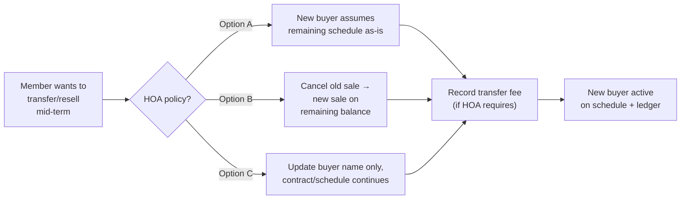

# Payment System Overhaul — Plan (Lot-For-Sale + Installment Payments)

**Date:** 2026-10-27
**Goal:** Turn the current HOA lot map into a real "lot for sale → sale plan → installment payments" payment scheme, with automated monthly bills, per-payment transaction IDs, and a clear installment breakdown report (preview → export). Membership fees and the monthly-dues flow stay **unchanged** (per the user's instruction: "let membership the same").

---

## ⭐ Most Important (Must-Haves)

This is the short list — the things that cannot be missing from the final system. If a decision or a build step conflicts with anything below, the item below wins.

1. **Automatic price from area × rate.** The moment a lot's `areaSqm` and the flat per-sqm rate are known, the system computes the selling price. No hand-typed prices.
2. **Automatic installment scheduling.** Selling a lot generates the entire payment schedule (all periods, due dates, amounts) instantly — nothing manual per month.
3. **Transaction ID on every payment.** Each installment gets a unique, human-readable reference (e.g. `LP-2026-001-007`) that appears on receipts, statements, and reports.
4. **Clear per-payment breakdown.** Every payment shows its due date, amount, principal, interest, and the **remaining balance** after it — readable by member and HOA alike.
5. **Remaining balance always visible.** The outstanding balance on a lot appears on the map/pin, the statement, and the report summary — computed from the schedule, always correct.
6. **Preview-then-export reports.** The report shows exactly what will be exported — you see it before you download the CSV/PDF. Same data, same rows.
7. **Membership stays untouched.** Membership fees and monthly-dues flows are not changed by this overhaul. (User instruction.)
8. **Promissory Note support.** The buyer signs a PN; the system can generate it, attach the schedule, and store the signed copy.
9. **Audit trail.** Every sale, payment, and transfer records who did it and when — the HOA can trace every peso.
10. **Transfer/resale handled once decided.** Decision 5 (assumption vs. restructure) must be answered before build — the plan supports whichever the HOA picks.

> These 10 are the spine of the system. Everything else in this document (screens, filters, permissions) hangs off them.

---

## ⭐⭐ The Complete Flow — Flowchart + Detailed Explanation

Below is the end-to-end flow of how the whole payment scheme works, both as a flow diagram and a step-by-step walk-through. This is the "how we do it" picture of the entire scheme — this is the picture to show in your interview (Section 10) so the decision-maker confirms it matches how the HOA actually wants it to run.

```mermaid
flowchart TD
    A["Settings →<br/><b>Set flat rate per sqm</b><br/>(e.g. ₱2,000/sqm)]" --> B["Lot on map<br/>(has areaSqm)"]
    B --> C["<b>Mark Lot For Sale</b><br/>price = areaSqm × rate<br/>(auto-computed)"]

    C --> D{"Member wants<br/>to buy?"}
    D -->|No| C
    D -->|Yes| E["<b>Record Sale</b><br/>pick buyer,<br/>down payment, term,<br/>interest, term"<br/>(or full cash)"]

    E --> F["Create<br/><b>lot_sales</b> record"]

    F --> G["Generate<br/><b>Promissory Note</b><br/>(generated + signed)"]

    G --> H["<b>Automatically generate<br/>N installment periods</b><br/>each with its own<br/>transaction ID +<br/>principal &amp; interest<br/>+ remaining balance"]

    H --> I["<b>Monthly payment</b><br/>member pays<br/>(per schedule)"]

    I --> J{"Did member<br/>pay?"}

    J -->|Yes| K["Mark payment<br/>→ assigned to<br/>next unpaid period<br/>→ balance reduces"]

    J -->|No| L["Past grace period?<br/>(e.g. 5 days)"]

    L --> T{"Payment received?"}

    T -->|Yes| K
    T -->|No| M["<b>Overdue</b><br/>penalty applies<br/>(R.A. 6552 aware)"]

    M --> N{"How many installments<br/>already paid?"}

    N -->|2+ years worth| R["HOA process:<br/>demand letter<br/>→ 60-day notice<br/>→ refund equity<br/>(R.A. 6552)"]

    N -->|Under 2 years| S["HOA process:<br/>cancellation<br/>→ retain 10%<br/>→ refund balance"]

    R --> U["Lot relisted for sale"]
    S --> U["Lot relisted for sale"]
    U --> C

    K --> P{"All periods<br/>paid?"}

    P -->|No| I
    P -->|Yes| Q["<b>Paid Off</b><br/>balance = 0"]

    Q --> O["Issue Deed of Absolute Sale<br/>lot unassigned →<br/>member becomes owner"]

    style A fill:#dbeafe,stroke:#1d4ed8
    style C fill:#fff7ed,stroke:#ea580c
    style E fill:#fce7f3,stroke:#db2777
    style H fill:#d1fae5,stroke:#059669
    style K fill:#d1fae5,stroke:#059669
    style P fill:#fef3c7,stroke:#d97706</style>
```

### The flow step-by-step: each scenario

**Scenario 1 — Setting the price (the admin)**
1. Settings → HOA officer enters the flat rate per sqm (e.g. ₱2,000/sqm). This is the single config value.
2. For each lot on the map, the officer records (or already has) its `areaSqm`.
3. "Mark Lot For Sale" auto-computes the price: `price = areaSqm × ratePerSqm`. A preview shows `${area} sqm × ₱${rate} = ₱${price}`. Nothing is hand-typed.

**Scenario 2 — Selling the lot (the admin)**
1. From the For-Sale lot's dialog, "Record Sale":
   - Pick the buyer member
   - Enter optional down payment, term (e.g. 120 months = 10 years), interest rate (if any)
2. The system creates the `lot_sales` record (status `active`).
3. It generates the **Promissory Note** document (if the HOA has a template, it fills it; otherwise it uses the built-in template) — buyer signs (wet or e-sign, per HOA policy).
4. It computes the monthly payment and **auto-generates N `lot_payments` records** — each with its own transaction ID, due date, principal/interest split, and running remaining balance.
5. The lot status → `occupied` (with the buyer now the owner), and the map pin shows the remaining balance.

**Scenario 3 — Monthly payment (the member via the HOA)**
1. Payment day: the member pays an amount (over-the-counter at the HOA office, bank deposit, GCash, or other HOA-accepted channel — from interview Q9).
2. The HOA officer records the payment in the system:
   - If it equals the scheduled amount → the period is marked `paid`, its remaining balance is now shown as paid.
   - If it's more → excess flows to the next unpaid period(s) automatically.
   - If it's less → held as a credit/partial on the current period (from Q10/Q11).
3. Every posted payment carries the period's transaction ID and appears in the statement.

**Scenario 4 — Overdue / default (the HOA enforced by the system)**
1. A period passes its due date and the grace period (e.g. 5 days). The system flags it `overdue` and applies the flat penalty (existing logic).
2. From the interview (Q18): the HOA triggers its demand-letter process at some number of unpaid months. The system should track these lifecycle events (per `lot_sales`).
3. If the HOA cancels: the buyer's equity follows R.A. 6552 (Q20) — the system computes what's refundable, cancels/writes off the schedule, relists the lot, and the cycle restarts.

**Scenario 5 — Transfer / resale mid-term (Decision 5 — open, confirm with HOA in Q14–Q16)**
- Selected approach changes only the middle of the flow below (the schedule/balance handling); the outer flow is the same.



**Scenario 6 — Reports (the admin)**
1. Open Reports → choose filters (period, type, sale, member).
2. **Preview** renders the statement exactly as the export will (transaction IDs, principal/interest, remaining balance per period, per-sale summary card).
3. Hit **CSV** or **PDF** — same data, same rows, exported with the HOA letterhead on the PDF.

---

All six scenarios share the same root: **`lot_sales` owns the terms, `lot_payments` owns the money schedule.** That's the whole scheme in one line.

---

## 1. What you asked for, in one picture

A lot in the map is put **for sale** with a **flat rate per square meter** → the lot's price = `areaSqm × ratePerSqm`. The lot is paid **in installments** (e.g. 10-year = 120 monthly payments). Every payment gets a **transaction ID** and a **breakdown** (period, due date, payment amount, principal vs interest, remaining balance). Reports must **preview first** → then **export** (CSV / PDF), showing the full installment breakdown with the **remaining balance** per installment and the outstanding balance clearly visible.

---

## 2. Current state (what already exists)

| Concept | Already in the system |
|---|---|
| Lot area | `areaSqm` already exists on `LotModel` (already on lots + entered in the lot dialogs) |
| Lot price | `price` already on `LotModel` (already on lots + entered in the lot dialogs) |
| "For Sale" | `LotStatus.forSale` already exists |
| `payments` | `PaymentType.lotPayment` already exists (invoice status: paid/unpaid/overdue/waived) |
| `member_ledgers` | ledger docs already exist (`annualTarget`/`currentBalance`) |
| Reports | PDF + CSV export already exist (`reports_screen.dart`) |

**The gap** — what's missing for a real payment scheme:

| Missing | Why we need it |
|---|---|
| A per-sqm **rate** config (flat rate per square meter) | So `price = areaSqm × rate` is *derived*, not hand-typed |
| A **sale record** per lot (= "this lot is sold to this buyer") | The link between the lot and its payment plan |
| An **installment schedule** (term, due dates, per-period amounts) | The "10-year payment" structure |
| A **transaction ID** on each payment | The unique reference shown on receipts/reports |
| Payment **breakdown** fields (principal, interest, remaining balance) | The clear per-payment breakdown |
| **Automated generation** of installment records | "Automates everything" — sell once, schedule 120 payments |
| **Preview-then-export** report flow | Report breakdown visible before it's exported |

---

## 3. The new data model

We add **two new collections** and reuse the existing `payments` collection. (Everything below is additive — no change to existing `dues`/`membershipFee` records, enum values, or ledger semantics.)

### 3.1 `sales_rate` (per-sqm flat rate, one doc)

```
sales_rate/config
├── ratePerSqm: 2000.0        // Price per square meter
├── updatedBy: string
└── updatedAt: Timestamp
```

- Stored in the **Settings → When you "Save"/"Mark For Sale", the system auto-computes `price = areaSqm × ratePerSqm`.** The lot dialog's Price field becomes read-only derived, with a live preview (`120 sqm × ₱2,000 = ₱240,000`).

### 3.2 `lot_sales` (a sale record per lot)

```
lot_sales/{saleId}
├── lotId: string             // References the lot
├── phase, block, lotNumber   // Snapshot for display
├── buyerUid: string          // References the member who buys
├── buyerName: string         // Snapshot for display
├── ratePerSqm: double
├── areaSqm: double           // Snapshot at sale time
├── totalPrice: double        // areaSqm × ratePerSqm
├── downPayment: double       // Optional initial payment
├── financedAmount: double    // totalPrice − downPayment
├── termMonths: int           // e.g. 120 (10 years)
├── annualInterestRate: double // e.g. 0.06 (6%)
├── monthlyPayment: double    // computed amortization (financedAmount → schedule)
├── status: active | paidOff | cancelled
├── soldDate: Timestamp
├── createdBy / updatedBy: string
└── updatedAt: Timestamp
```

> The `price` field on the lot itself is a snapshot of `totalPrice` shown on the map/pin.

### 3.3 `lot_payments` (installment schedule — one doc per payment)

```
lot_payments/{paymentId}
├── saleId: string            // belongs to a sale
├── lotId: string             // for lookup
├── buyerUid / buyerName: string
├── period: int               // 1..termMonths
├── transitId: string         // e.g. "LP-2026-001-007"
├── dueDate: Timestamp
├── amount: double            // scheduled monthly payment
├── principalPortion: double  // amount going to principal
├── interestPortion: double   // amount going to interest
├── remainingBalance: double  // balance after this payment
├── status: scheduled | paid | overdue | waived
├── paidAt: Timestamp?
├── paidBy: string
└── createdAt: Timestamp
```

**Transaction ID format:** `LP-{YY}-{saleSequence}-{period}` such as `LP-2026-001-007`. The transaction id is generated when the sale is recorded.

---

## 4. Auto-generation flow ("automates everything")

1. **Config set** — On the Settings screen there is just one place to enter the **flat rate per sqm** (e.g. ₱2,000/sqm).
2. **Mark lot for sale** — In the lot dialog, "Mark For Sale" now auto-computes `price = areaSqm × ratePerSqm` (can't save without a rate/area), so every lot's selling price is always consistent.
3. **Sell to a member** — Admin opens a "Record Sale" flow: pick the buyer member, set down payment (default 0), term (months, e.g. 120), interest rate (e.g. 6%). The system immediately:
   - Creates the `lot_sales` record,
   - Computes the **monthly payment** with the standard amortization formula `M = P·r·(1+r)^n / ((1+r)^n − 1)` and builds the full schedule (principal, interest, balance per period),
   - Optionally auto-creates an initial down-payment `lotPayment` record with its own transaction ID,
   - **Automatically generates N monthly `lotPayments` records**, one per period, each with its own unique `transactionId`, due date, principal/interest split, and running `remainingBalance`.
4. **Paying** — Instead of manual "Mark Paid" per record, the admin simply records a payment amount (or picks "pay this period"); the system assigns the next unpaid period's transaction ID, marks that period paid, and posts any excess to the next period(s) automatically. Overpayment / partial payment is handled cleanly by the split logic.
5. **Overdue** — Existing `applyOverduePenalties` logic continues to work unchanged for installment records (grace days + flat penalty) — no change needed from this plan.

Because each payment record already carries its own `remainingBalance` after that payment, the **balance shown on reports is trustworthy without computation** — and the `member_ledgers` pattern can be reused so the dashboard's "Outstanding" is O(1).

---

## 5. Amortization — how the numbers are split

Standard loan amortization (this is exactly what real-estate "payment scheme" breakdowns look like):

| Period | Due Date | Payment | Principal | Interest | **Balance** |
|--------|----------|---------|-----------|----------|------------|
| 1 | 2026-11-01 | ₱2,130 | ₱1,330 | ₱800 | ₱238,670 |
| 2 | 2026-12-01 | ₱2,130 | ₱1,336 | ₱794 | ₱237,334 |
| 3 | 2027-01-01 | ₱2,130 | ₱1,343 | ₱787 | ₱235,991 |
| 4 | 2027-02-01 | ₱2,130 | ₱1,350 | ₱780 | ₱234,641 |
| … | … | … | … | … | … |
| 119 | 2036-09-01 | ₱2,130 | ₱2,120 | ₱10 | ₱2,120 |
| 120 | 2036-10-01 | ₱2,127 | ₱2,120 | ₱7 | **₱0** |

The **last period absorbs rounding** so the final balance lands exactly on ₱0 (this is the standard way it's done, and why the final payment can differ by a few pesos).

---

## 6. Reports: preview first, then export

The current `reports_screen.dart` already exports CSV and PDF — we keep that and **add a preview pane** in front of it:

1. **Filter** — period, payment type, sale, member (already supported).
2. **Preview** — a live on-screen table/statement shows exactly what the export will contain:
   - **Per-lot statement:** transaction ID, period, due date, amount, principal, interest, balance, status.
   - **Per-sale summary card:** total price, down payment, term, monthly payment, total paid, **remaining balance**.
3. **Export** — buttons for CSV and PDF render the *same* currently-previewed data (same query, same rows). PDF already supports print/share (`Printing.sharePdf`).

The report needs **no new math**: every row is read straight from the generated schedule's `principalPortion / interestPortion / remainingBalance` / `transactionId` fields.

---

## 7. Screen changes (web-admin)

| Screen | Change |
|---|---|
| **Settings** | Add "price per sqm" rate field (new `sales_rate` config). |
| **Location map** (`lot_dialogs`) | "Mark For Sale" auto-computes price = area × rate. New **"Record Sale"** action on `ForSaleLotDialog`: pick buyer, set terms, generate schedule. |
| **Payments** | New "Installment Plans" tab/section listing active `lot_sales` with progress bar (paid vs balance); "Record Payment" posts to the next unpaid period. |
| **Add Payment screen** | Support choosing a sale and paying a specific period (or any amount → auto-distributed). |
| **Reports** | Add preview pane with the statement table + per-sale summary + remaining balance; keep CSV/PDF exports. |
| **Mobile** | Member sees their lot: statement preview (transaction IDs, paid/next due, remaining balance); no changes to membership/dues screens. |

---

## 8. Open decisions for you to confirm

| # | Decision | Options | Recommendation |
|---|----------|---------|----------------|
| 1 | Down payment required? | Required % (e.g. 20%) or 0 by default | 0 by default; configure later |
| 2 | Interest rate | 0% (flat equal payments) or charged interest (e.g. 6%) | Charge interest — matches real-estate amortization |
| 3 | Payment frequency | Monthly, quarterly, or annual | Monthly (matches typical mortgage) |
| 4 | "For sale" cash option | Pure cash + no installment vs. always installments | Support both — cash (no schedule) or installment |

### Decision 5 — What happens on resale / mid-term transfer (needs research)

This is the one that needs more thought. Here's what the research turned up to help you decide:

**Philippine legal context:**
- **R.A. 6552** (Realty Installment Buyer Protection Act) governs installment property sales in the PH — it sets rules for cancellation, forfeiture, and refund if a buyer defaults. The HOA's reassignment policies should stay within these bounds.
- If the original buyer has paid **less than 2 years** of installments and defaults, the seller (HOA) can cancel and retain at most **10% of total payments** — the rest must be refunded.
- If the original buyer has paid **2+ years**, the HOA must give **60 days written notice** to cure the default. On cancellation, the buyer is entitled to a refund (minus a small admin fee) — in practice this is the buyer's accumulated equity.

**Common approaches in Philippine real estate:**

| Approach | How it works | Pros | Cons |
|---|---|---|---|
| **A — Full assumption** | New buyer "assumes" the existing schedule as-is. Remaining balance and term continue unchanged. The old buyer is replaced with the new buyer on the `lot_sales` record; future payments go to the new buyer. | Simplest to implement. Matches "transfer of rights" practice in PH — widely used. | New buyer may inherit the original terms (which may not reflect current market). |
| **B — New schedule (restructure)** | Old sale is closed/cancelled. A new `lot_sales` is created using the **remaining balance** as the new financed amount, with fresh terms (same rate, or new rate). | HOA can adjust terms (e.g. new rate, new term). | More complex; voids the original schedule (requires clean close-out logic). |
| **C — Sale of rights (informal)** | Original buyer formally sells their *contractual rights* to a new buyer. The HOA acknowledges the transfer, updates the owner name, but the schedule and terms remain under the original contract. Common in informal PH resale. | Lightweight from a system standpoint. | HOA may prefer a formal assumption for accountability. |

The most common practice in Philippine HOAs and developer subdivisions is **Approach A (full assumption)** — it mirrors how a deed of sale with assumption of mortgage works, and is referenced in detail in these resources:
- [Respicio — Requirements for Assume Balance Real Estate Transactions](https://www.respicio.ph/commentaries/requirements-for-assume-balance-real-estate-transactions-and-contract-to-sell-philippines)
- [Respicio — Transfer of Rights to Installment Property in the Philippines](https://www.respicio.ph/commentaries/transfer-of-rights-to-installment-property-in-the-philippines)
- [FasterCapital — Sell my land contract: How to Transfer Your Land Contract to a New Buyer](https://fastercapital.com/content/Sell-my-land-contract--How-to-Transfer-Your-Land-Contract-to-a-New-Buyer.html)
- [Law Insider — Assignment of Rights in Installment Sale Agreement](https://www.lawinsider.com/clause/assignment-of-rights-in-installment-sale-agreement)
- [R.A. 6552 full text — Realty Installment Buyer Protection Plan](https://chanrobles.com/republicacts/republicactno6552.html)

**HOA software precedent for ownership transfer:**
HOA management platforms (Buildium, AppFolio, etc.) typically handle ownership transfer as a **workflow**: (1) request from seller/new buyer → (2) HOA approval → (3) sale closed/cancelled → (4) new owner assigned → (5) ledger updated. See: [ResiNara — HOA Ownership Transfer Software: A Practical Workflow](https://resinara.com/resources/articles/hoa-ownership-transfer-software/).

**Practical design decision you need to make:**

> When a lot with active installments is resold mid-term, does the new buyer **assume the exact remaining schedule** (Option A), or does the HOA **close the old sale and restructure** (Option B)? — And should there be a **transfer fee** (common in HOAs to discourage speculation)?

Most PH subdivisions charge a **transfer processing fee** on resale regardless of approach — typically ₱500–₱2,000 — which is trivial to add as a field.

**System-level implication for each approach:**

- **Approach A:** Close the old `lot_sales` (status → `assumed`), re-assign `buyerUid`/`buyerName` to the new buyer. The installment schedule stays — `lot_payments` records are updated with the new buyer's name/uid. Transaction IDs continue sequentially. Remaining balance is unchanged.
- **Approach B:** Close the old `lot_sales` (status → `restructured`). Void un-paid periods from the old `lot_payments`. Create a fresh `lot_sales` with `financedAmount = remainingBalance`, generate a new schedule. Old paid periods are preserved as history for audit.
- **Approach C:** Update `buyerUid`/`buyerName` only on the `lot_sales` and unpaid `lot_payments` — no schedule voiding, no new generation. Simplest, least change. The old transaction IDs stay with the record (traceable to original buyer).

A practical middle ground: **support Approach A as the default, with a transfer fee field**. Approach B can be deferred to a later iteration. Approach C is effectively what Approach A does minus the formal close-out.

---

## 8b. All options remain open — pending stakeholder confirmation

Decisions 1–5 are **all open**. This plan is a living document. Before any implementation begins:

> **⚠️ Need to confirm with the HOA decision-maker (previous owner / authorized signatory) before finalizing any of the options below.** The interview guide in Section 10 is built for exactly this conversation. Once confirmed, we'll lock in each decision and update this section.

| # | Decision | Options | Status |
|---|----------|---------|--------|
| 1 | Down payment | 0% / 10% / 20% / custom % | **Open** |
| 2 | Interest rate | 0% (flat) / 6% / 8% / custom | **Open** |
| 3 | Payment frequency | Monthly / quarterly / annual | **Open** |
| 4 | Cash sale option | Cash-only OR cash + installment | **Open** |
| 5 | Resale / mid-term transfer | A (assume) / B (restructure) / C (informal) / transfer fee amount | **Open** |

> **Note on Decision 5:** All three approaches (A, B, C) are documented above. The HOA may have an existing practice or preference — confirm in the interview. The system should be built to support at minimum the approach the HOA chooses.

---

## 9. Promissory Note

A **Promissory Note** (PN) is a signed legal document where the buyer formally promises to pay the installment amount on the agreed schedule. In Philippine real estate, it is almost always attached to the **Contract to Sell** — it secures the seller's right to collect and serves as evidence of the buyer's obligation if disputes arise.

### 9.1 What goes into the Promissory Note (data from the system)

| Field | Source in system |
|---|---|
| Buyer name and address | `members` collection (member's full name, address) |
| Lot description | `lot_sales` + `lots` (`phase • block • lotNumber`, area, location) |
| Total purchase price | `lot_sales.totalPrice` |
| Down payment amount paid | `lot_sales.downPayment` |
| Financed amount | `lot_sales.financedAmount` |
| Annual interest rate | `lot_sales.annualInterestRate` |
| Term (months) | `lot_sales.termMonths` |
| Monthly amortization | `lot_sales.monthlyPayment` |
| First due date | First `lot_payments` due date |
| Outstanding balance / schedule | `lot_payments` schedule |
| Lender / HOA name | `hoa_settings.name` |
| Lender / HOA address | `hoa_settings.address` |
| Date of execution | System date when sale is recorded |
| Signatories | Buyer (member) + HOA authorized signatory |

### 9.2 How the system uses the Promissory Note

- **Generation:** When a sale is recorded ("Record Sale" flow), the system can generate a **PN document** (PDF) pre-filled with the above fields — ready for wet signature or e-signature. The HOA can upload a PN template (their own letterhead format) and the system fills in the buyer's data and schedule.
- **Schedule attachment:** The PN typically includes the full amortization schedule (or at minimum the monthly payment amount and term). The pre-generated `lot_payments` schedule is the exact content to attach.
- **Signed copy storage:** The signed PN should be stored — either as a scanned PDF uploaded to Firestore under the `lot_sales` document, or as a photo attached in the lot detail screen.
- **Trigger for legal action:** If a buyer goes overdue past the R.A. 6552 grace period, the system flags the account — the PN is the document the HOA presents to support any demand letter or legal proceedings.

### 9.3 What's still open for the PN

- [ ] Does the HOA have an existing PN template they use, or do we create one from scratch?
- [ ] Does the HOA's lawyer need to review and approve the PN format before the system generates it?
- [ ] Is e-signature acceptable, or must all PNs be wet-signed in person?
- [ ] Where are signed PNs stored — physical file, scanned in the system, or both?

---

## 10. Stakeholder Interview Guide — questions to answer before finalizing

Use this guide when you interview the HOA's decision-maker (the person authorized to set payment policies — typically the President, Treasurer, or authorized officer). The goal is to fill in every open decision in Section 8 and any additional policies the HOA wants to embed.

> **Note:** All options in Section 8 remain open until this interview is completed and decisions are confirmed. Do not begin implementation until the interviewee has signed off or you have written confirmation.

---

### Theme A — Pricing & rate

**Q1.** What should be the **price per square meter** for this subdivision? (e.g. ₱2,000/sqm — this becomes the single config value in `sales_rate`)

**Q2.** Will the rate **differ by phase or block** (e.g. premium phase costs more per sqm), or is one flat rate for the whole subdivision?

**Q3.** Should lots have a **minimum/maximum area** requirement? Can a member buy multiple lots?

---

### Theme B — Down payment & interest

**Q4.** When a member buys a lot on installment, is a **down payment required**?
- If yes: what percentage or fixed amount? (e.g. 20% of total price, or ₱50,000 minimum)
- If no: all financing can start from 0 down.

**Q5.** Should the HOA charge **interest** on the financed amount (like a real mortgage), or a flat zero-interest equal monthly payment over the term?
- If interest: what rate? (common is 6–12% per annum in PH subdivisions)
- If zero interest: are there other fees instead (e.g. admin fee, processing fee)?

**Q6.** What is the **maximum term** the HOA is willing to offer? (e.g. 10 years / 120 months is the example in this plan)

---

### Theme C — Cash sale vs. installment

**Q7.** Can a lot be sold **entirely in cash** (one full payment, no installment schedule)?
- If yes: does the cash buyer still sign a PN or just a Deed of Sale?

**Q8.** For a cash sale, what documents does the HOA issue? (e.g. Deed of Absolute Sale, Receipt)

---

### Theme D — Monthly payment process

**Q9.** How does a member **make a payment**? (e.g. over-the-counter at HOA, bank deposit, GCash/online transfer, auto-debit)

**Q10.** What happens if a member **pays more than the scheduled amount** in a given month — does the excess go toward the next period, or is it held as a credit?

**Q11.** What happens if a member pays a **partial amount** (less than the scheduled amount) — is it accepted, or must it be the exact scheduled amount?

**Q12.** Is there a **grace period** before a late payment is flagged as overdue? (e.g. 5 days after the due date — the system already supports this via `penaltyGraceDays`)

**Q13.** Are there any **fees beyond the installment** (e.g. one-time transfer fee, processing fee, documentary stamp) that should appear on the schedule?

---

### Theme E — Resale / mid-term transfer (Decision 5)

**Q14.** If a member wants to **resell / transfer their lot** to another person while installments are still being paid, what does the HOA require?
- Must the new buyer *assume* the existing schedule at the same terms? (Option A)
- Or does the HOA prefer to **restructure** — cancel the old schedule, create a new one with a new term/amount based on the remaining balance? (Option B)
- Is there an informal arrangement where the new buyer just pays under the old member's name? (Option C — not recommended but possible)

**Q15.** Does the HOA charge a **transfer fee** when a lot changes hands mid-term? If yes, how much? (Common in HOAs to discourage speculation: ₱500–₱5,000)

**Q16.** What **documentation** does the HOA require from both the selling and buying member before a transfer is processed? (e.g. Deed of Absolute Sale between members, transfer request form, NBI clearance, HOA clearance)

**Q17.** Can a member with an **overdue account** transfer or resell their lot? Or must the account be fully paid first?

---

### Theme F — Default, cancellation, and R.A. 6552

**Q18.** When a member **defaults** (fails to pay), what is the HOA's standard process?
- How many months of non-payment triggers action? (e.g. 2 months → letter, 3 months → demand, 6 months → cancellation)
- Does the HOA have its own written policy, or does it follow R.A. 6552 strictly?

**Q19.** Does the HOA have a list of **accredited notifiers** (e.g. legal counsel) for sending demand letters?

**Q20.** In case of cancellation, does the HOA have a process to **resell the lot** and refund the buyer's equity (per R.A. 6552 — after 2 years, buyer gets back the payments made minus 5% admin fee)? Who handles the resale in the system?

---

### Theme G — Promissory Note & documents

**Q21.** Does the HOA have an **existing Promissory Note template** (with their letterhead, logo, format) that they want the system to use?
- If yes: can you share it so we can build the fill-in template?
- If no: should we create a standard one and have the HOA's lawyer review it?

**Q22.** Does the HOA require the buyer's **spouse to co-sign** the Promissory Note or Contract to Sell?

**Q23.** What documents does the HOA give the buyer **after full payment**? (e.g. Deed of Absolute Sale, Tax Declaration transfer, Certificate of No Lien) — should the system track issuance of these?

---

### Theme H — Reports & export

**Q24.** Who receives the **monthly payment reports**? (e.g. Treasurer, President, Board)
- Email auto-send? Or only on demand?

**Q25.** Should the **preview report** show per-member statements, per-lot statements, or both?

**Q26.** What **filters** do they want on reports? (e.g. by phase, by payment status, by due date range, by sale date)

---

### Theme I — System access & roles

**Q27.** Who in the HOA can **record a sale** / generate the schedule? (Admin only, or Officers too?)

**Q28.** Who can **mark payments as paid**? (Admin only, or can Officers do this?)

**Q29.** Can members see their **own installment schedule** on the mobile app?

**Q30.** Should the HOA have an **audit log** for every sale recorded, every payment posted, and every transfer — who changed what, and when?

---

### After the interview

Once you've completed the interview, come back to this plan and:

1. Update **Section 8b** with the confirmed answers
2. Mark each question above with the answer you received
3. Add any new decisions discovered that aren't in this guide
4. This document then becomes the **signed-off requirements** before implementation starts

---

## 11. Implementation order (after decisions 1–5 are confirmed)

1. `SalesRate` config + settings UI.
2. `LotSaleModel` + `LotPaymentModel` (schedule) + transaction-ID generator.
3. Amortization math service + unit tests (schedule sums exactly to financed amount; final balance = 0).
4. "Record Sale" flow in lot dialogs (auto-generates schedule).
5. Payment recording (pay-a-period, auto-distribute, transaction IDs).
6. Reports preview + per-sale statement/summary (CSV/PDF reuse).
7. Mobile statement view.
